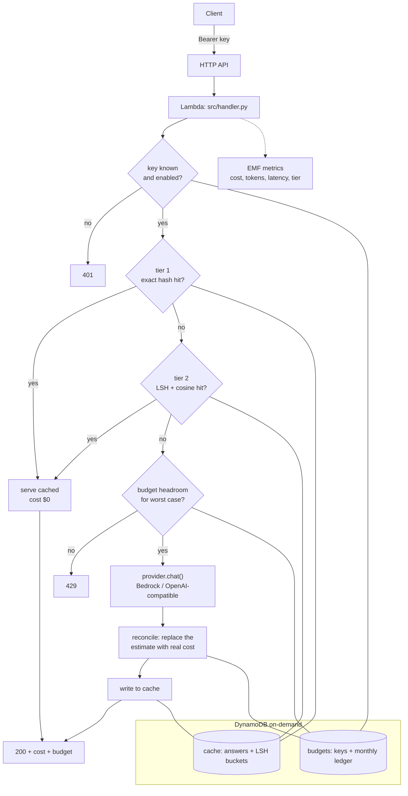

# llm-gateway

A serverless proxy that sits between your application and an LLM provider, and
answers the two questions a bill never does: **who spent this, and could we have
avoided spending it?**

- **Per-key budgets that cannot be raced.** Each API key has a monthly cap
  enforced by a single conditional DynamoDB update, so concurrent Lambda
  invocations cannot both squeeze through the same last dollar.
- **A two-tier cache.** Exact repeats are free. Paraphrases are found with
  multi-band LSH over embeddings and confirmed by cosine similarity — so
  "what's the refund window?" and "how long do I have to ask for a refund?"
  share one answer.
- **Costed telemetry.** Every request emits a CloudWatch Embedded Metric Format
  record with its dollar cost, token counts, latency and cache tier. No
  `PutMetricData` call, no extra IAM permission, dashboards for free.
- **Pay-per-use throughout.** Lambda, HTTP API and on-demand DynamoDB. Idle
  traffic means an idle bill.

Provider-agnostic: Amazon Bedrock by default, any OpenAI-compatible endpoint as
an alternative, and a local `echo` adapter so the whole thing — budgets, cache,
metrics — runs offline with no account and no spend.

```bash
pip install -e ".[dev]"
make demo    # full request lifecycle against mocked AWS, ~2s
make bench   # measures the cache: hit rate, precision, net saving
make test    # 87 tests, no credentials required
```

The same 87 tests also run against a **real DynamoDB** — `make local-up &&
make local-test` — because the two things most worth trusting here, the
un-raceable conditional update and the `Decimal` spend ledger, are exactly what
a mock can get subtly wrong. One environment variable picks the backend and
nothing in `src/` knows the difference. CI runs both on every push, with no
secrets. See [docs/local-development.md](docs/local-development.md).

## Measured

`make bench` replays a labelled query stream through the real cache. Every query
carries a `group`; queries in the same group are paraphrases that *should* share
an answer, so a hit across groups is a wrong answer served to a user — which
makes cache precision a number rather than a hope.

```
 thresh   hit rate   precision   exact    sem   net saved   saved %
-------------------------------------------------------------------
   0.80     33.3%        1.00       1      7  $ 0.000758     32.9%
   0.85     25.0%        1.00       1      5  $ 0.000583     25.3%
   0.90     20.8%        1.00       1      4  $ 0.000486     21.1%
   0.92     12.5%        1.00       1      2  $ 0.000277     12.0%
   0.95     12.5%        1.00       1      2  $ 0.000277     12.0%
```

**24 queries, 11 paraphrase groups: 33.3% served from cache with zero wrong
answers, for a 32.9% net saving.**

"Net" is doing real work in that sentence. The cache embeds on lookup *and* on
write, and those embedding calls are charged in the figures above. A savings
number that ignores the cache's own cost is not a savings number.

Two honest caveats: the sample set is small and its hit rate reflects how much
repetition it contains, not a universal truth; and it is measured with the
`echo` adapter's bag-of-words embeddings, which separate paraphrases far worse
than a real embedding model. Replace `bench/queries.sample.jsonl` with a sample
of your own traffic before trusting any threshold.

## How it works



Three ordering decisions carry the design:

**Cache before budget.** A hit costs nothing upstream, so it should not need
headroom. A key that has spent its entire limit still gets served what the
gateway already knows — which is also the behaviour you want during an incident.

**Reserve the worst case, then reconcile.** Admission control needs a number
before the provider is called, so the gateway charges `max_tokens` at the output
rate up front, then replaces that estimate with the real cost once usage comes
back. This is why the demo's gate closes while actual spend is still well under
the limit: the headroom is the overshoot guarantee.

**Reconcile in `finally`.** If the provider call raises, the reservation is
refunded. Without this, every failed request would permanently eat budget.

### The budget cannot be raced

Two invocations for the same key can check a budget at the same instant and both
decide there is room. So the check and the increment are one operation:

```
ADD spend_usd :estimate
IF  attribute_not_exists(spend_usd) OR spend_usd <= (limit - :estimate)
```

DynamoDB evaluates the condition and applies the increment atomically. Spend can
therefore exceed the limit by at most one in-flight estimate, no matter how many
invocations race — asserted directly in
`tests/test_budget.py::test_overshoot_is_bounded_by_one_estimate`.

### The semantic cache brings its own index

DynamoDB has no vector index, so the cache implements random-hyperplane LSH.
One hyperplane separates two vectors with probability θ/π, so a `k`-bit bucket id
matches end to end with probability `(1 - θ/π)**k`. Real paraphrases sit near
cosine 0.85, where that term is ≈ 0.823 — and at `k=16` a single table recovers
only **4.5%** of them. Probing neighbouring buckets scales terribly: three
bit-flips of a 16-bit id is 697 lookups.

So the cache uses `L` independent tables of `k` bits — the OR half of an AND/OR
construction, where a candidate is recovered if any table agrees:

```
recall = 1 - (1 - (1 - θ/π)**k) ** L
```

At the defaults `k=8, L=12`: **94%** recall at cosine 0.85, **99.9%** at 0.95,
with each bucket holding ~1/256 of the cache. `scripts/lsh_recall.py --compare`
prints the whole table, so the two constants can be re-derived for your
embedding model rather than inherited on faith:

```bash
python scripts/lsh_recall.py --compare
```

LSH only *shortlists*. The winner is decided by an exact cosine comparison
against `CACHE_THRESHOLD`, so a bad bucket guess costs a miss, never a wrong
answer.

Storage keeps vectors in one place: the answer row holds the embedding, and each
band row is a tiny pointer to it. One cached response is 1 fat row + 12 thin
ones, not 12 copies of a 1,024-float vector.

### Deployed layout

```
pk = "apikey#<sha256(key)>"                     sk = "meta"       -> key_id, limit, enabled
pk = "spend#<key_id>"                           sk = "<YYYY-MM>"  -> spend, tokens, counters
pk = "exact#<sha256(request)>"                  sk = "v1"         -> answer + embedding
pk = "lsh#<seed>.<L>x<k>#<model>#<band>#<sig>"  sk = "<sha256>"   -> pointer
```

API keys are stored only as SHA-256 hashes: the table never holds a usable
credential, and a leaked table dump cannot be replayed against the gateway.

## Deploy

Needs the AWS SAM CLI, credentials, and Bedrock model access enabled in your
region.

```bash
make deploy                      # Lambda (arm64) + HTTP API + 2 tables + alarm
make seed-key LIMIT=5 LABEL=dev  # prints an API key once; stored hashed
make usage                       # spend, requests and hit rate per key
make destroy                     # removes everything
```

```bash
curl -s "$API_URL/chat" \
  -H "Authorization: Bearer $GATEWAY_KEY" \
  -H 'Content-Type: application/json' \
  -d '{"model":"anthropic.claude-3-5-haiku-20241022-v1:0",
       "messages":[{"role":"user","content":"say hi"}]}' | jq
```

```json
{
  "text": "Hi there.",
  "cached": false,
  "cache_tier": "miss",
  "cost_usd": 0.000102,
  "usage": { "input_tokens": 11, "output_tokens": 23 },
  "budget": { "limit_usd": 5.0, "spend_usd": 0.000102, "remaining_usd": 4.999898 }
}
```

| Route | Method | Purpose |
|---|---|---|
| `/chat` | POST | Proxied completion, with cost and budget in the response |
| `/usage` | GET | This month's spend, requests, cache hits and tokens for the calling key |
| `/health` | GET | Liveness, no auth |

### Configuration

| Variable | Default | Notes |
|---|---|---|
| `LLM_PROVIDER` | `bedrock` | `bedrock`, `openai-compat`, or `echo` for local work |
| `CACHE_THRESHOLD` | `0.92` | Minimum cosine for a semantic hit; calibrate with `make bench` |
| `CACHE_LSH_BANDS` | `12` | More bands → higher recall, more reads per lookup |
| `CACHE_LSH_BITS` | `8` | More bits → tighter shortlist, lower recall |
| `CACHE_LSH_SEED` | `1337` | Changing bands, bits or seed retires existing entries by design |
| `CACHE_SEMANTIC` | `1` | `0` leaves only the exact tier |
| `CACHE_TTL_SECONDS` | `604800` | DynamoDB TTL expires rows at no cost |
| `BEDROCK_EMBED_MODEL` | `amazon.titan-embed-text-v2:0` | Cache vectors |

## What this costs to run

The model tokens dominate; the AWS side of a stack like this is noise at
portfolio scale. Structurally:

- **Lambda** — per request, arm64 (cheaper per GB-second than x86_64), 512 MB,
  typically tens of milliseconds outside the provider call.
- **HTTP API** — per request, and throttled to 10 rps so a runaway client loop
  cannot become a surprise bill.
- **DynamoDB** — on-demand, so reads and writes only. A semantic lookup is 12
  small queries plus up to 32 point reads; a write is 1 row with the vector plus
  12 pointers. Cached rows expire via TTL, which DynamoDB does not charge for.
- **CloudWatch** — EMF metrics on two dimensions only (`key_id`, `model`);
  cardinality is what makes custom metrics expensive. Log retention is set
  explicitly, because log groups default to *never expire* and quietly become the
  biggest line on the bill for a stack this small.

Current prices are on AWS's own pages and change; `src/pricing.py` carries the
model price sheet with the date it was checked, and unknown models fall back to a
deliberately high default so nothing is ever accounted as free.

Everything in `make test`, `make demo` and `make bench` runs against mocked AWS
and the `echo` provider: **$0.00 and no credentials.** CI has no secrets, by
design — if it ever needs one, something has leaked into the test path.

## Layout

```
src/
  handler.py            request lifecycle, routing, response shaping
  budget.py             conditional-update guardrail + monthly ledger
  cache.py              exact tier, multi-band LSH, cosine rescoring
  pricing.py            model price sheet, pre-flight token estimates
  telemetry.py          CloudWatch EMF records
  tables.py             table schema shared by tests, demo and bench
  providers/
    base.py             the Provider contract
    bedrock.py          default; Converse API + Titan embeddings
    openai_compat.py    OpenAI, Groq, Together, vLLM, Ollama
    echo.py             local-only; hashing-trick embeddings
bench/
  demo.py               end-to-end transcript against mocked AWS
  replay.py             hit rate, precision, net saving, threshold sweep
scripts/
  seed_key.py           mint a key with a budget
  report_usage.py       per-key spend table
  lsh_recall.py         recall for any (bands, bits) geometry
template.yaml           SAM: Lambda, HTTP API, 2 tables, alarm, log retention
```

### Adding a provider

Implement `chat` and `embed` from `src/providers/base.py`, then register it:

```python
from src.providers import register
register("my-backend", MyBackendProvider)
```

Nothing else changes — budgets, caching, accounting and metrics all talk only to
the `Provider` interface.

## Limits worth knowing

- **Non-streaming.** Streaming responses and a response cache pull in opposite
  directions; this deliberately does the cacheable half.
- **Shortlist caps.** A lookup reads at most 8 rows per band and rescores at most
  32 candidates. On a very large cache a hot bucket can therefore hide a better
  match behind an acceptable one.
- **Budgets are monthly and per key.** No daily caps, no org-level rollup.
- **One embedding model per cache.** Changing it invalidates stored vectors;
  bump `CACHE_LSH_SEED` to retire them cleanly.
- **Estimates are heuristic.** Admission control uses a characters-per-token
  ratio, script-aware because Arabic and other non-Latin text tokenizes less
  efficiently. Accounting always uses the provider's reported usage.

## License

MIT
